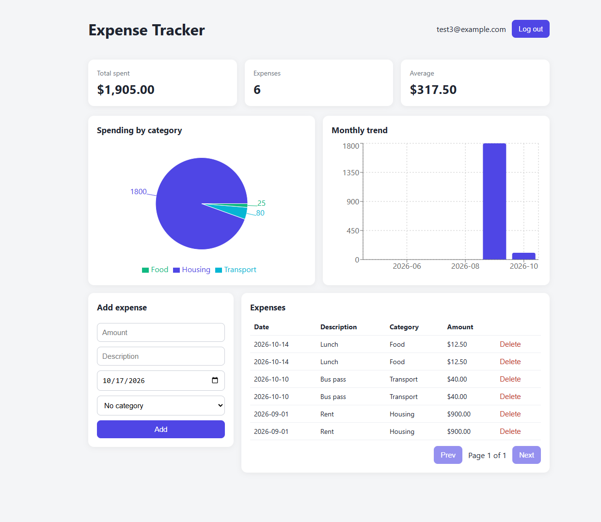

# Expense Tracker

Full-stack expense tracking app with authentication, category management, and spending analytics.



## Features

- JWT authentication with bcrypt-hashed passwords
- Expense CRUD with date and category filters, plus pagination
- Per-user categories (7 defaults seeded on signup)
- Dashboard with summary cards, a spending-by-category pie chart, and a monthly trend chart
- Strict per-user data isolation, covered by automated tests

## Tech stack

- **Backend:** FastAPI, SQLAlchemy 2.0, Pydantic, SQLite (PostgreSQL ready), pytest
- **Frontend:** React (Vite), React Router, Recharts, Axios
- **DevOps:** GitHub Actions CI

## Architecture

```
backend/app/
  core/        config, database session, security helpers
  auth/        register, login, JWT, current-user dependency
  categories/  category CRUD
  expenses/    expense CRUD, filters, pagination
  analytics/   SQL aggregations for the charts
frontend/src/
  api/         axios client and endpoint helpers
  features/    auth, dashboard, expenses
```

Each backend module has its own models, schemas, service, and router.

## Run locally

Backend:

```bash
cd backend
python3 -m venv venv
source venv/bin/activate
pip install -r requirements.txt
echo "SECRET_KEY=$(openssl rand -hex 32)" > .env
uvicorn app.main:app --reload
```

Frontend (in a second terminal):

```bash
cd frontend
npm install
npm run dev
```

API docs are at http://localhost:8000/docs and the app at http://localhost:5173.

## Tests

```bash
cd backend
pytest
```

## Design decisions

- Money is stored as `Numeric`/`Decimal`, never floats
- Aggregations run in SQL, not Python loops
- Every query is scoped by `user_id`
- Business logic lives in service modules, so routes stay thin
